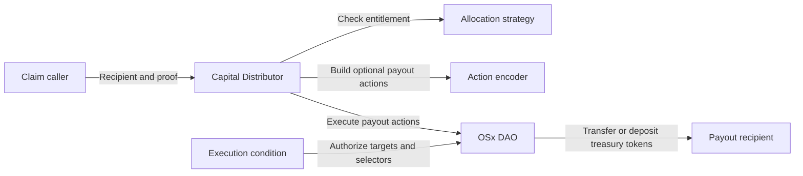

# Capital Distributor [![Github Actions][gha-badge]][gha] [![Foundry][foundry-badge]][foundry] [![License: AGPL v3][license-badge]][license]

[gha]: https://github.com/aragon/osx-capital-distributor/actions
[gha-badge]: https://github.com/aragon/osx-capital-distributor/actions/workflows/ci.yml/badge.svg
[foundry]: https://getfoundry.sh/
[foundry-badge]: https://img.shields.io/badge/Built%20with-Foundry-FFDB1C.svg
[license]: https://www.gnu.org/licenses/agpl-3.0
[license-badge]: https://img.shields.io/badge/License-AGPL%20v3-blue.svg

Capital Distributor is an Aragon OSx plugin for paying token allocations from a DAO treasury. A DAO creates a campaign,
specifies who can claim and how payouts are delivered, and lets recipients claim their allocation onchain.

The included Merkle strategy supports distributions from a recipient list. It can serve airdrops, grants, rewards, or
allocations calculated from gauge votes. Your protocol calculates the amounts and publishes the proofs; the plugin
checks claims and asks the DAO to execute the payments.

## Is it a fit for your protocol?

Use Capital Distributor when a DAO needs recipients to claim allocated ERC-20 tokens, with campaign timing, pause
controls, and a record of amounts already claimed. A campaign can pay tokens directly or use an action encoder to
deposit them into a configured vault.

Your team supplies the allocation calculation, recipient data, proof delivery, claim interface, and treasury funding.
Creating a campaign records its configuration without reserving or transferring its budget. Successful claims depend on
the DAO having the funds and permission to execute every payout action.

These guides describe the contracts in this checkout. The [deployment guide](docs/deployment.md) explains installation;
the [integration guide](docs/integration.md) covers campaign creation, proofs, claims, and updates.

## Included strategies and payout paths

| Component                  | Behavior                                                                                     | Source                                                                                          |
| -------------------------- | -------------------------------------------------------------------------------------------- | ----------------------------------------------------------------------------------------------- |
| Merkle allocation strategy | Verifies a recipient and their total entitlement against a campaign root                     | [MerkleDistributorStrategy](src/allocatorStrategies/MerkleDistributorStrategy.sol)              |
| Direct transfer            | Asks the DAO to transfer tokens to the payout address; selected with encoder ID `bytes32(0)` | [CapitalDistributorPlugin](src/CapitalDistributorPlugin.sol)                                    |
| Vault deposit encoder      | Builds an approval and a `deposit(uint256,address)` call to a campaign's vault               | [VaultDepositPayoutActionEncoder](src/payoutActionEncoders/VaultDepositPayoutActionEncoder.sol) |

The vault encoder assumes the vault accepts the configured token and credits the supplied recipient. It does not check
the vault's asset or set a minimum number of shares. Additional allocation strategies or payout methods require
implementations of [IAllocatorStrategy](src/interfaces/IAllocatorStrategy.sol) or
[IPayoutActionEncoder](src/interfaces/IPayoutActionEncoder.sol), registration in the relevant factory, and DAO
authorization for the resulting payout calls.

## How a claim works



1. The DAO creates a campaign with an allocation strategy, payout token, optional encoder, and time bounds.
2. A caller submits a claim. The strategy returns the recipient's total entitlement.
3. The plugin subtracts the amount already claimed and any configured strategy fee, then records the new claimed total.
4. The DAO executes the recipient payout and fee transfer. A reverting execution rolls back the claim record.

Anyone can submit `claimCampaignPayout` for a recipient; the payout remains assigned to that recipient. A holder who
wants to redirect their own allocation uses `claimCampaignPayoutToAddress`, which verifies entitlement for `msg.sender`.

## Campaign controls and fees

Claims require an active campaign within its time bounds. The start is inclusive and the end is exclusive; zero disables
the corresponding time bound. A campaign manager can pause, resume, or permanently end a campaign before its end time.

The Merkle strategy permits root updates while `isCampaignPaused(campaignId)` is true. Previously claimed amounts remain
recorded, so replacement roots describe total entitlements rather than additional payouts. Increasing a recipient's
total from 1,000 to 1,200 units after they have claimed 1,000 makes another 200 units available before fees.

Strategy registration sets a fee recipient and rate, capped at 1,000 basis points (10%) by the strategy factory. Each
claim deducts the fee from the newly claimable amount, rounding the fee up to the next token unit. The DAO transfers
that fee alongside the recipient's payout.

The [integration guide](docs/integration.md) gives the exact claim data, accounting queries, and root-update sequence.

## Installation and authority

[CapitalDistributorPluginSetup](src/CapitalDistributorPluginSetup.sol) installs an upgradeable plugin and an
`ExecuteSelectorCondition` helper. The DAO receives campaign management, metadata, upgrade, and condition-management
permissions. The plugin receives conditional permission to execute DAO actions.

The condition starts with no allowed calls. Before claims can succeed, the DAO must allow the token transfer call and
any approval or vault deposit calls required by its campaigns. Campaign creation alone does not grant those permissions.

Factory registration is permissionless and each type ID can be registered only once. The implementation and fee terms
stored under an ID therefore matter when selecting a strategy; an ID's name is not evidence of who registered it.

Sources: [plugin setup](src/CapitalDistributorPluginSetup.sol),
[strategy factory](src/factories/AllocatorStrategyFactory.sol),
[encoder factory](src/factories/ActionEncoderFactory.sol),
[execution-condition integration tests](tests/integration/ExecuteConditionIntegrationTest.t.sol).

## Local development

Install [Foundry](https://getfoundry.sh/), [Bun](https://bun.sh/), and Git. The repository configures Solidity 0.8.29;
its CI uses Foundry v1.3.0. Solidity dependencies are installed through Bun into `node_modules` using the checked-in
lockfile.

```sh
git clone https://github.com/aragon/osx-capital-distributor.git
cd osx-capital-distributor
bun install --frozen-lockfile
forge build
forge test
```

| Command                   | Purpose                                           |
| ------------------------- | ------------------------------------------------- |
| `bun run lint`            | Check Solidity formatting and Prettier formatting |
| `forge test -vvv`         | Run tests with detailed failure output            |
| `forge coverage`          | Generate a coverage summary                       |
| `forge test --gas-report` | Report gas used by tested calls                   |

The [CI workflow](.github/workflows/ci.yml) uses the `ci` profile, which raises fuzz runs from 1,000 to 10,000.

## Guides and source

| Goal                                                          | Read                                                                                                                                     |
| ------------------------------------------------------------- | ---------------------------------------------------------------------------------------------------------------------------------------- |
| Create campaigns, serve proofs, and integrate claims          | [Integration guide](docs/integration.md)                                                                                                 |
| Configure deployment, installation, and execution permissions | [Deployment guide](docs/deployment.md)                                                                                                   |
| Generate Merkle roots and proof files                         | [Merkle tools](script/utils/README.md)                                                                                                   |
| Look up campaign structs and external methods                 | [Plugin interface](src/interfaces/ICapitalDistributorPlugin.sol)                                                                         |
| Extend allocation or payout behavior                          | [Strategy base](src/allocatorStrategies/AllocatorStrategyBase.sol), [encoder base](src/payoutActionEncoders/PayoutActionEncoderBase.sol) |
| Review tests                                                  | [Test directory](tests/)                                                                                                                 |
| Review audit material                                         | [Audit directory](audits/)                                                                                                               |

Audit reports apply to their stated code revisions and scope. The directory also contains a report for a voting-escrow
payout encoder, which is not included in this checkout's `src/payoutActionEncoders/` directory.

## License

[GNU Affero General Public License v3.0 or later](LICENSE.md).
